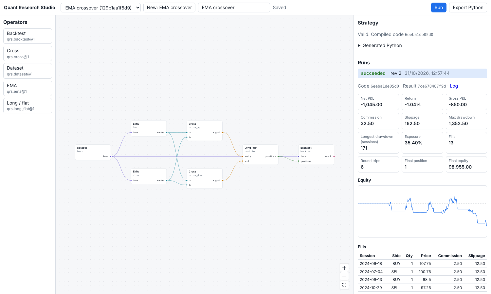

# Quant Research Studio

A local application for building trading strategies as typed visual graphs, compiling them to
readable Python, and running reproducible backtests on NautilusTrader. Stage 2 (foundation)
delivered the contracts, compiler, worker, immutable data, run records, standalone export and an
EMA crossover template. Stage 3 (technical MVP) adds SMA, Bollinger Bands, RSI and MACD; rules
composed from typed nodes; long/flat and long/short positions; CSV import; SMA crossover and
Bollinger/RSI templates; the visual builder; and run comparison. Stage 4 (in progress) adds feature
tables, forward-return labels and walk-forward ridge regression, with a ridge forecast template.



No live trading, LLM integration or corn-research integration exists yet; see
[docs/decisions.md](docs/decisions.md) for scope, and [docs/verification.md](docs/verification.md)
(Stage 2) and [docs/stage-3-verification.md](docs/stage-3-verification.md) for evidence.

## Setup

Requires Python 3.12, [uv](https://docs.astral.sh/uv/) and Node.js 20 or later.

```sh
uv sync                                   # Python environment from uv.lock
(cd apps/studio && npm ci && npm run build)
uv run qrs demo                           # synthetic dataset + EMA crossover strategy in .qrs/
uv run qrs serve                          # http://127.0.0.1:8765
```

Application data (SQLite index, datasets, run directories) lives in `.qrs/`, which Git ignores.
Use `--home` to choose another directory. A run that takes longer than 30 minutes is stopped; set
another limit with `qrs serve --time-limit MINUTES`.

For UI development, run `uv run qrs serve` and, in `apps/studio`, `npm run dev` (Vite proxies
`/api` to the service).

## Using it

- **New strategy**: start from an empty canvas or a template (EMA crossover, SMA crossover,
  Bollinger/RSI mean reversion, ridge return forecast, news and technical trend, or economic report
  and ML) with datasets of the kinds it needs. The gallery shows the market
  conditions each template is designed for; each also ships a fixture CSV with its expected fills.
- **Import CSV**: map a file's columns and declare its date format, price unit, exchange calendar
  and instrument; rejected rows are listed by row number, and missing sessions are reported.
- **Edit**: drag or click operators from the palette, grouped by family, and connect ports of the
  same type (colour shows the type). Each node shows its effective warm-up. Set parameters in the
  side panel. Undo and redo with the buttons or Ctrl/Cmd+Z and Ctrl/Cmd+Shift+Z; rapid edits to one
  field are one step.
- **Save**: edits autosave as numbered revisions. A save based on an outdated revision is refused
  and reported. Edits that could not be saved are kept in the browser and offered for restoring
  when the strategy is next opened.
- **Run**: runs are queued in the service and executed one at a time in a worker process. Closing
  the browser does not affect them. A run can be cancelled while queued or running.
- **Inspect**: metrics, equity, fills, code/result hashes and the worker log for each run.
  Re-run a run to repeat its strategy revision; the new run links to the one it repeats.
- **Compare runs**: choose two or more succeeded runs on one dataset. They are compared over a common
  window starting at the latest warm-up, with metrics recomputed from each run's ledger, equity
  overlaid, and parameter differences listed. Differing costs or assumptions are flagged.
- **Export**: downloads a ZIP that installs from its hashed dependency lock and runs without the
  studio (`python run.py`), producing the same `result_sha256` as the studio run.
- **Experiments** (**Experiments…**): search a strategy revision's parameters with a grid, or a
  seeded random search, of at most 200 trials. Each trial is a run that reads only the sessions
  before the holdout start. Follow the trials as they finish, see them ranked by an objective metric
  over their common window with each run's evidence class, compare the top ones, or cancel the
  rest. The holdout is evaluated only when asked, after a confirmation; every evaluation is
  recorded, and repeats are flagged across experiments that share the same bars and holdout start.
  A strategy reading exploratory data, such as features a model extracted after the fact, runs only
  as an exploratory experiment, whose results are labelled and kept apart from verified ones.

The same is available from the command line:

```sh
uv run qrs import bars.csv declaration.json    # import daily bars as a dataset (see below)
uv run qrs run strategy.json --out out/        # compile and run in-process
uv run qrs run strategy.json --out out/ --until 2025-01-02   # read no data from that date on
uv run qrs experiment experiment.json          # queue an experiment's trials for `qrs serve` to run
uv run qrs export strategy.json bundle.zip     # standalone Python bundle
uv run qrs schema                              # regenerate schemas/qrs.schema.json
```

### Importing CSV files

A CSV file of daily bars becomes an ordinary immutable dataset. The declaration is a JSON
`ImportDeclaration` (see `schemas/qrs.schema.json`):
- which header holds the date, open, high, low and close
- the date format, e.g. `%Y-%m-%d`
- the price unit: `currency`, or `cents` (divided by 100)
- the venue's exchange calendar, a [pandas_market_calendars](https://github.com/rsheftel/pandas_market_calendars)
  name such as `CBOT_Agriculture`, or `null` to expect every weekday
- the instrument, evidence class, source and whether the data may be redistributed

A file is rejected, with the row number of each problem, for any of these:
- an unparsable or missing value; prices must be plain decimal numbers
- a row with more values than the header has columns, such as an unquoted thousands separator
- a duplicate or out-of-order date
- an inconsistent high or low
- a price off the tick grid
- settlement-only data

Prices are never filled. Expected sessions missing from the file are listed in the manifest's
`import_report`; without a calendar the list is labelled `weekdays (approximate)`. The service
accepts the same import at `POST /api/datasets/import`: the file is the `text/csv` body, at most
10 MB, and the declaration is the JSON-encoded `declaration` query parameter.

A CSV file of observations, such as a published rate with its revisions, imports the same way with
an `ObservationsDeclaration` (`"kind": "qrs/observations"`): the headers holding the event date, the
publication timestamp and, optionally, a revision label and a true/false estimated-timestamp flag;
the event date format; each value column with its unit; and, if any timestamp is estimated, how.
Every publication timestamp needs an explicit UTC offset, such as `2024-11-26T16:30:00-05:00`. The
**As of** node joins a value column onto bars imported with an exchange calendar, using at each
session's close only what was published by then. Importing observations is CLI and API only.

A CSV file of documents, such as news stories or economic reports, imports the same way with a
`DocumentsDeclaration` (`"kind": "qrs/documents"`): the headers holding each document's ID, its
publication timestamp and its text and, optionally, a title, an event date (with its format), a
revision label for each version, an estimated-timestamp flag and a source URL, which is kept as
metadata and never fetched. The declaration must say whether the text may be sent to a hosted model
provider (`hosted_processing`). Each row is one version of a document; versions of one document need
distinct revision labels and publication times. No node reads documents directly. Importing
documents is CLI and API only.

### Extracting features from documents

`qrs extract extraction.json` builds a feature dataset from documents, through a model's structured
answers. The extraction file (`Extraction` in the schema) names:
- the documents dataset and the provider, model and endpoint
- the instructions, and a prompt in which `{title}` and `{text}` are the only placeholders
- the numeric fields to extract, each with its unit and bounds
- the declared processing latency, a capture label, and a budget

`--record` asks the provider for responses not yet stored, within the budget, and stores each in
`.qrs/responses/`. Without it, the command only replays stored responses and never calls a
provider, so a recorded extraction rebuilds the same dataset offline. Each row is usable from its
document's publication plus the processing latency. AI outputs captured after that time are
classed `exploratory`. Strategies read the features with the **As of** node, like any observations.

Providers:
- **`fixture`:** answers from a JSON file, offline; for tests and templates.
- **`ollama`:** a local model served by [Ollama](https://ollama.com) on this machine. The endpoint,
  such as `http://127.0.0.1:11434`, must be a loopback address; proxies are never used; and the
  model must be pulled locally, not a remote one. Set `options.num_ctx` to the model's context
  length: an extraction is refused unless that window holds every request whole.
- **`anthropic`:** Claude through the Anthropic API. Install the optional extra
  (`uv sync --extra hosted`, or `pip install "qrs[hosted]"`), set `ANTHROPIC_API_KEY`, and import
  the documents with `"hosted_processing": true`. Otherwise their text is never sent.

## Adding an operator

An operator is a Python function registered with typed ports, a Pydantic parameter model, a
palette family and a temporal policy (its warm-up). It must be causal, and
`tests/test_operator_contracts.py` checks that for every registered operator, using default
parameters, so every parameter other than a dataset reference needs a default. The editor,
validator, compiler, worker and exporter read it from the registry, so none of them change. [examples/extension/qrs_roc.py](examples/extension/qrs_roc.py) is a complete example, with a
rate of change that outputs a series and a candle shape that outputs a feature table:

```sh
PYTHONPATH=examples/extension QRS_OPERATOR_MODULES=qrs_roc uv run qrs serve
```

## Tests

```sh
uv run pytest                                  # Python: numerics, simulation, service, parity
(cd apps/studio && npm test && npm run typecheck)
uvx ruff check src tests examples
(cd apps/studio && npm run build) && uv run playwright install chromium && uv run pytest -m e2e   # the studio in a browser
```

`scripts/local-gate.sh` runs everything CI checks, on your machine, stopping at the first failure.
- **Locks:** `uv.lock`, `runtime.lock` and the studio's lock file.
- **Code:** lint, and the committed schema and types.
- **Studio:** its tests, typecheck and build.
- **Tests:** the whole Python suite and the browser tests, offline in a network namespace where Linux provides one (`unshare` and `ip`), online otherwise.
- **Export parity:** `scripts/check-exports.sh`, which needs network access.
- **Historical hashes:** the Stage 2 demo's and each bars-only template's code and result hashes (`scripts/check-hashes.py`). Result hashes are compared on Linux x86_64 only.

After changing a contract in `src/qrs/contracts.py`, run `uv run qrs schema` and
`npm run gen:types` in `apps/studio`; a test fails if the committed schema is stale.

### Continuous integration

- **CI** (`.github/workflows/ci.yml`), on Ubuntu, is the standard gate:
  - **When it runs:** once per push to a pull request, on its merge with the base branch; on pushes to `main` and `v*` tags; and by hand. A newer push to a pull request cancels its older run, and a pull request with a merge conflict is not checked until the conflict is resolved. Every push to `main` is checked.
  - **`python (ubuntu-latest)`:** the whole Python suite, offline in a network namespace, then ruff.
  - **`export`:** each template's bundle reproduces its CLI run in a fresh virtualenv.
  - **`e2e`:** the browser tests, offline.
  - **`studio`:** generated types, typecheck, Vitest and the build.
- **Full verification** (`.github/workflows/full-verification.yml`) runs the Python suite on macOS 15, the second platform the exit criteria name. A macOS minute is billed as ten Linux minutes, so it runs only:
  - on a pull request labelled `full-ci`: a final integration pull request, before it is merged. Adding the label starts it, and it runs again on each later push.
  - on a release candidate tag, such as `v0.5.0-rc1`.
  - by hand, once the workflow is on `main`.

  On other pull requests its `python (macos-15)` check is skipped, using no runner.

To verify a branch fully:

```sh
gh label create full-ci --description "Run full verification (macOS) on this pull request"   # once
gh pr edit <number> --add-label full-ci            # macOS on the pull request, merged with its base
gh workflow run full-verification.yml --ref <branch>   # or by hand, for any branch
gh workflow run ci.yml --ref <branch>                  # the Ubuntu checks by hand
```

A final integration pull request is ready to merge when its head has passed both workflows.

## Layout

| Path | Responsibility |
| --- | --- |
| `src/qrs/contracts.py` | Canonical models: strategy document, operator info, dataset manifest, run info |
| `src/qrs/registry.py`, `ports.py`, `operators/` | Operator registry, typed port values, built-in operators |
| `src/qrs/templates.py`, `templates/` | Versioned strategy templates, each with a fixture CSV and its expected fills |
| `src/qrs/graph.py`, `compiler.py` | Graph validation and deterministic Python generation |
| `src/qrs/runtime.py`, `worker.py` | Executing compiled strategies and writing run records |
| `src/qrs/comparison.py` | Comparing runs over a common window |
| `src/qrs/simulation.py`, `analytics.py` | NautilusTrader adapter and ledger metrics |
| `src/qrs/datasets.py`, `importer.py` | Immutable, content-addressed datasets, the synthetic generator and CSV import |
| `src/qrs/store.py`, `jobs.py`, `api.py`, `cli.py` | SQLite index, durable jobs, HTTP API, CLI |
| `src/qrs/export.py` | Standalone bundles |
| `apps/studio/` | React + React Flow editor (types generated from `schemas/`) |
| `docs/` | Decisions, NautilusTrader evaluation, verification evidence, reuse manifest |

## Licence

Copyright © 2026 Joshua Borrill. All rights reserved.

This is publicly inspectable proprietary source code, not open source. No permission is granted to use, copy, modify, distribute, sublicense, sell or otherwise exploit it without Joshua Borrill's prior written permission, except as GitHub's Terms of Service require for public repositories. See [LICENSE](LICENSE). Third-party dependencies and data remain under their own licences and attribution terms.

## About this public release

This repository is a fresh public snapshot of private development at source revision `5a5fc9b` (2026-11-09). Commit hashes, branch names and pull-request numbers cited in the documentation refer to that private history and are not available here.
